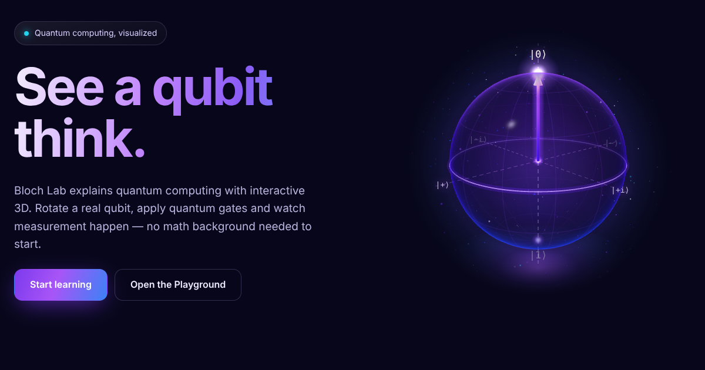

# Bloch Lab

**Learn quantum computing visually.** Bloch Lab is an interactive, beginner-friendly website that explains qubits, the Bloch sphere, measurement and quantum gates with a hand-built 3D visualization.

🔗 **Live site:** https://blochlab.spaceexplorer.wiki



## Features

- **Real-time 3D Bloch sphere** built directly on Three.js with custom GLSL shaders: glass sphere with Fresnel rim light, glowing state arrow, rotation-axis highlight, motion trail, measurement flash and particle field.
- **Exact quantum simulation.** States are complex amplitude vectors and gates are 2×2 unitary matrices. Animations come from each gate's actual rotation axis and angle, extracted from its matrix (SU(2) → SO(3)).
- **Lessons written for search and for beginners:** every page opens with a two-sentence answer, has interactive widgets, formulas rendered with KaTeX, FAQ blocks and structured data (Schema.org `LearningResource`, `FAQPage`, `BreadcrumbList`, `DefinedTermSet`).
- **Playground:** build a single-qubit circuit, step forward and back on the sphere, run 1000 measurement shots and share the circuit by link.
- **Fast and static:** pre-rendered HTML for every page (Nuxt SSG), with the 3D engine lazy-loaded only after the page appears.
- **Responsive and accessible:** works on phones (touch-friendly controls, horizontal drag that doesn't block page scrolling), keyboard rotation, `prefers-reduced-motion` support and a WebGL fallback.

## Tech stack

| Area | Tools |
| --- | --- |
| Framework | Nuxt 4 (Vue 3, TypeScript), static site generation |
| 3D | Three.js, custom shaders, CSS2D labels, fat lines |
| Math | Hand-written complex-number and qubit library (`app/lib/quantum`) |
| Formulas | KaTeX (rendered at build time) |
| Tests | Vitest (the quantum core is unit tested) |
| Hosting | GitHub Pages with GitHub Actions |

## Project structure

```
app/
  lib/quantum/        complex numbers, qubit states, gates, rotation extraction
  lib/three/          BlochScene — the Three.js scene
  components/bloch/   BlochSphere, QubitLab, BlochExplorer, ShotsLab
  components/content/ LessonShell, Tex, KeyIdea
  pages/              home, lessons, playground, glossary
  data/               lesson list and glossary
server/routes/        sitemap.xml and robots.txt
tests/                unit tests for the quantum core
```

## Run locally

```bash
npm install
npm run dev        # http://localhost:3000
npm test           # quantum core unit tests
npm run generate   # static build in .output/public
```

## Roadmap

- Multi-qubit circuits with CNOT
- Entanglement and Bell states, with visual correlations
- Interference and Grover's search algorithm in 3D
